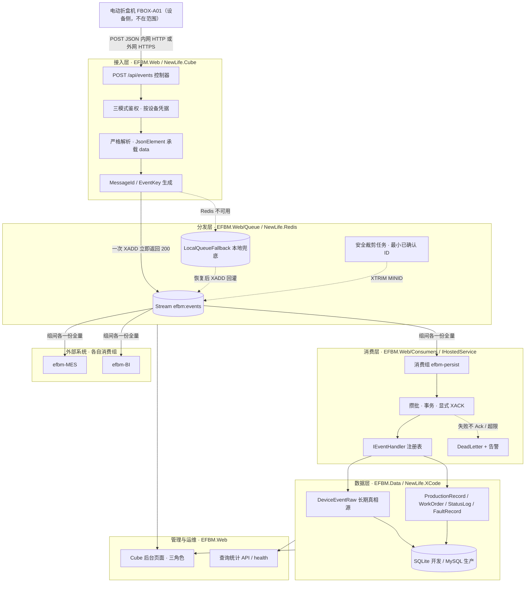
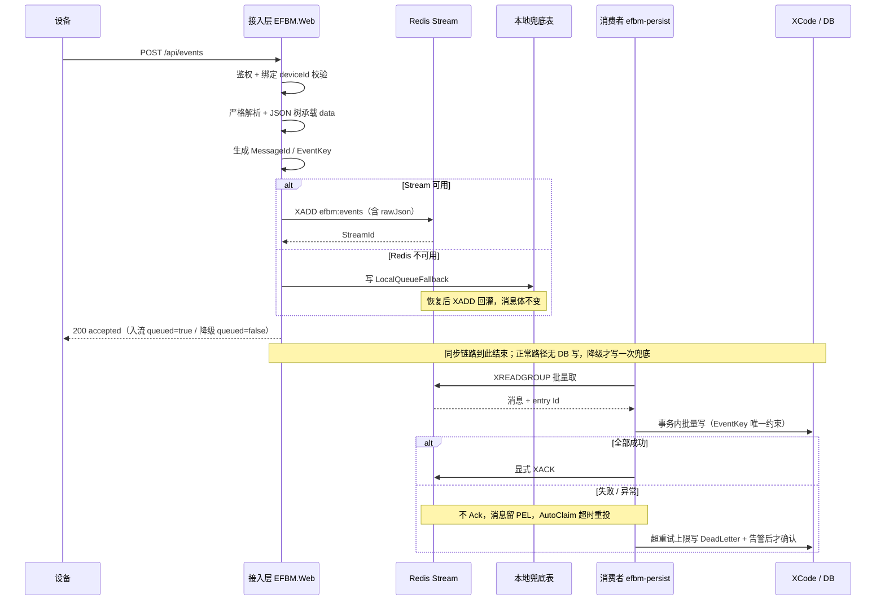
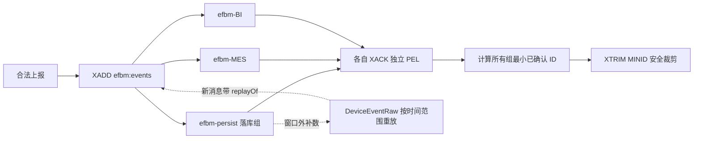
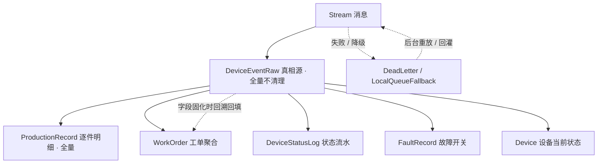
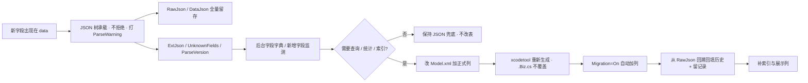

# EFBM 设备上报 API 后端 · 架构设计

> 日期：2026-11-11 ｜ 对应：[需求说明](../需求说明.md)（WHAT）· [开发计划](../开发计划.md)（阶段与验收）· [功能清单](功能清单.md)（完成状态）· [竞品分析](竞品分析.md)（选型依据）
> 本文只回答「怎么实现」，不重复需求文档里的功能描述。与根目录三份文档同属讨论完善阶段，不标版本号、不保留修订记录。

## 0. 竞品前置检查与适用范围

按官方 `development-process` §2.3 的「竞品前置检查」，架构设计开始前需确认同行做法。本项目是**设备厂商配套的纯接收端**，不对外部商业产品选型，结论见 [竞品分析](竞品分析.md)：无外部商业竞品，改为对可选技术路径做机制对比，**未核实的产品版本 / 许可 / Star 数据一律不写入文档**。因此本文的设计决策以「项目约束 + 已核实的 NewLife 组件机制」为依据，不引用未经核实的同行数据。

**适用范围**：本文覆盖本期全部模块（接收 → 分发 → 消费 → 落库 → 后台 → 部署）。二期节拍 / 产能看板只预留数据与扩展点，不在本文展开。

---

## 1. 整体架构

### 1.1 分层总览

### 1.2 设计原则

| 原则 | 落地方式 |
| --- | --- |
| **同步快进快出** | 接收层只做鉴权、解析、生成两个键、一次 `XADD`；没有任何数据库 IO，下游故障不改变 HTTP 响应 |
| **不丢优先于不重** | 设备失败不重发；至少一次投递 + PEL 重投 + 组重建重放都用 `EventKey` 唯一约束收敛，宁可重复投递也不静默丢弃 |
| **数据库是唯一长期真相源** | Stream 只作有限窗口的在线分发总线；窗口外数据从 `DeviceEventRaw` 重放；原始报文 100% 全量留存，也是「字段固化前」历史数据可补的前提 |
| **逻辑分层、物理收敛** | 4 个工程（`EFBM.Web` / `EFBM.Data` / `EFBM.Core` / `EFBM.Tests`），队列、服务、消费者作为 `EFBM.Web` 内的目录分层；只有一个入口应用，不预建空 Service 工程（D-11） |
| **接入层可替换** | 控制器只做接入；`EFBM.Core` / `EFBM.Data` 不引用 ASP.NET Core，二期换轻量宿主只需重写接入层 |
| **组间隔离** | 每个消费组独立 `XACK` 与 PEL，外部系统停机、堆积、组重建都不影响 `efbm-persist` 落库 |
| **简单优先，约 90% 覆盖** | 固定列 + JSON 兜底 + 回溯回填承接字段演进；不做动态建列 / EAV / 字段级版本化。扩展点预留不实现，见 §6 |
| **多系统共享是分发层职责** | 一次 `XADD` 多组全量分发，不在业务层做多次写入；外部系统自行管理组、确认与幂等 |

> Stream 负责「在线分发」，`DeviceEventRaw` 负责「长期留存」。任何设计都不得让 Redis 承担真相源职责。

### 1.3 核心组件与所在工程

按官方 `development-process` §2.3 要求，组件表必须标明物理位置。工程清单来自《开发计划.md》§2：4 个工程（`EFBM.Web` / `EFBM.Data` / `EFBM.Core` / `EFBM.Tests`），Queue / Services / Consumers 是 `EFBM.Web` 内的目录分层，取舍见 §5 决策表 D-11（已决议）。

| 组件 | 所在工程 | 职责 |
| --- | --- | --- |
| `EventsController` / `ApiResponse` | `EFBM.Web/Controllers`、`EFBM.Web/Models` | 唯一上报端点与冻结的统一响应体；只做 HTTP 适配（读原文、取凭据头与来源 IP），不含业务逻辑 |
| `EventEnvelopeParser` | `EFBM.Core` | 严格解析 + 宽容字段：`JsonDocument` 按名取值、W100~W108 告警、`DataJson` / `ExtJson` / `UnknownFields`、UTC 时间；P2 接收层与 P3 消费者共用 |
| `AuthModes` / `RequestAuthenticator` | `EFBM.Core` | 三模式鉴权、凭据绑定 `deviceId`、401 / 403 分级、定长时间比较 Secret |
| `EventIngestService` / `IngestResult` | `EFBM.Core` | 接收链路编排：解析 → 鉴权 → 生成两个键 → `XADD` → 200；按队列 / 兜底 / 日志三级降级，三者全失败才 503；每条请求写文本日志 |
| `RequestLogEntry` / `RequestLogOptions` / `IRequestLog` | `EFBM.Core` | 请求日志契约：字段、JSONL 序列化（固定字段序、空值省略）、脱敏规则、配置与自检；`IRequestLogProbe` 供 `/health` 读取状态 |
| `FileRequestLog` | `EFBM.Web/Logging` | 按天滚动 + 超限切分 + 保留期清理的文本日志实现：单信号量串行写、可选 `fsync`、异常只累加 `failed` 不抛出 |
| 契约类型与抽象 | `EFBM.Core` | `EventNames` / `EventEnvelope` / `StreamMessage` / `EventFieldRegistry` / `EventKeyBuilder` / `EfbmOptions` / `ParseWarnings`；`IEventQueue` / `IDeviceCredentialStore` / `ILocalFallbackStore` / `IEventHandler`、`FallbackEntry` |
| `DeviceCredentialStore` | `EFBM.Web/Services` | `AppCredential` 只读投影 + 进程内短 TTL 缓存；提供 `Invalidate` / `Clear` 供后台重置凭据时调用 |
| `LocalFallbackStore` / `FallbackRequeueService` | `EFBM.Web/Services` | 本地兜底写入 / 哨兵值查询 / 回灌状态；`IHostedService` 周期扫描并重新 `XADD`，失败只累加 `RetryCount` |
| `RedisEventQueue` / `QueueServiceExtensions` | `EFBM.Web/Queue` | `RedisStream<T>` 封装：`XADD`、惰性建组、PEL 优先读取、显式 `XACK`、接管自动裁剪与 `MaxRetry`；DI 惰性注册 |
| `StartupDiagnostics` / `HealthController` | `EFBM.Web/Services`、`EFBM.Web/Controllers` | 启动配置自检日志；`/health` 返回请求日志状态、Redis 连通性与兜底积压（P5 补 DB 与各组 lag） |
| `StreamTrimHostedService` / `IStreamTrimmer` / `StreamTrimCalculator` | `EFBM.Web/Queue`（**P4 已落地**） | 按各组最小已确认 ID 安全裁剪（`XTRIM MINID`）；`SafeTrimEnabled` / `RedisEnabled` 任一关闭即不自启，Redis < 6.2 自动停跑并记日志；`DeadLetterWriter` 由 P3 消费者在达 `ConsumerMaxRetry` 时写死信表完成 |
| `EventQueryService` / `EventReplayService` / `AdminEventsController`、`AdminDeadLettersController` | `EFBM.Web`（**P4 已落地**） | 后台只读检索（设备 / 事件 / 幂等键 / 处理状态 / 接收时间 / 原文关键词 + 分页）、原文详情、手动标记；单条与按范围批量重放均生成新 `MessageId` + `replayOf` 并广播所有组，死信重放成功才回写 `ReplayStatus`；接口走 Cube 登录态（`[Authorize]`），未认证 401 跳登录页 |
| `EventExportService` | `EFBM.Web`（**P4 已落地**） | 按接收时间导出 CSV（UTF-8 BOM、原文列完整、单次 20 万条上限），返回导出凭证（范围 + 最大主键 + 条数 + 文件 SHA-256，默认 30 分钟）；清理必须凭凭证，且只删 `Id ≤ 导出时最大主键` 的部分；**无自动清理任务** |
| `PersistConsumerService` | `EFBM.Web/Consumers`（**P3 已落地**） | `IHostedService` 落库组消费者：批量取、PEL 优先重投、显式 `XACK`；失败不 Ack 留 PEL、达 `ConsumerMaxRetry` 先写死信再确认，绝不静默丢弃；`RedisEnabled=false` 不启动（纯日志模式改走 `--replay`） |
| `EventPersistService` | `EFBM.Core` | 消费落库编排（FR-5~FR-9）：重解析 → `EventKey` 幂等 → 设备登记 → 分发 handler → 置位；对称于接收层，不依赖 ASP.NET Core 与 XCode 实体，可单测 |
| `IRawEventStore` / `IDeadLetterStore` / `IDeviceRegistry` | `EFBM.Core`（抽象）、`EFBM.Web/Services`（实现） | 原始报文 / 死信 / 设备登记三个存储抽象；`EventRawStore` 用 `DeviceEventRaw` 实体实现，并发撞唯一键翻译为 `DuplicateEventKeyException` |
| `EventHandlerRegistry` + 7 个 handler | `EFBM.Core`（注册表）、`EFBM.Web/Consumers/Handlers`（**P3 已落地**） | `ORDER_STARTED/PROGRESS/COMPLETED`、`DEVICE_STATUS_CHANGED`、`FAULT_OCCURRED/CLEARED` 处理器 + 未知事件兜底；按 `event` 字符串匹配 |
| `LogReplayRunner` | `EFBM.Web/Services`（**P3 已落地**） | `--replay <日志或目录>` 把 Beta 文本日志 `status=200` 的行重放进 `EventPersistService` 直落库，不经 Redis；幂等由 `EventKey` 兜住，重复回放安全；跑完退出不启动 Web |
| XCode 实体与 `.Biz.cs` | `EFBM.Data` | 10 张实体的查询封装与实体级业务方法；`Migration=On` 自动建表 / 加列；按月分表策略 |
| 后台 Controller / View | `EFBM.Web/Areas`、`EFBM.Web/Views`（P4 落地） | 需求说明 §6 页面清单；纳入 Cube 菜单与三角色权限 |
| 测试工程 | `EFBM.Tests` | **241 项**单元测试（解析 / 鉴权 / 编排 / 端点 / 回灌 / SQLite 自动建表 / 文本日志真实文件 / Beta 配置校验 / P3 消费编排幂等、6 类 handler 规则、死信与重复投递真实 SQLite / P4 安全裁剪纯算法 / P4 后台检索、分页、标记与重放语义 / P4 导出 CSV 转义与「先导出再删」凭证校验、按范围批量重放）；MySQL 双库矩阵与多消费组故障注入按阶段补 |

---

## 2. 模块设计

### 2.1 接收链路（同步，关键路径）

**职责**：在最短时间内把一条合法上报变成 Stream 里的一条消息并应答设备；不判断业务、**不做数据库写**、不推断设备侧逻辑。凭据按 AppKey 做进程内短 TTL 缓存，稳态连数据库读都不产生（首次或缓存失效时只读一次），匿名模式完全不查库。

| 职责 | 说明 |
| --- | --- |
| 鉴权 | 按 `AuthMode` 切换匿名 / Basic / AppKey+AppSecret；按 `AppKey` 查凭据，校验 Secret 与绑定 `deviceId` 一致。401 统一文案防探测，403 区分停用凭据 / 设备串用 / 外网匿名；`Basic` 复用同一张 `AppCredential` |
| 解析 | JSON 无法解析或缺少 `event` / `deviceId` / `timestamp` → 400 直接丢弃；其余只做最小校验 |
| 宽容承载 | `data` 用 `JsonElement`，按名取值 + 缺省值；字段缺失、类型不符、嵌套 / 数组、未知 `event`、未知 `status` 只打 `ParseWarning`（W100~W108），解析产物 `ExtJson` / `UnknownFields` 不进 Stream 消息体 |
| 键生成 | `MessageId`（UUID，追踪用）、`EventKey = SHA1(event\|deviceId\|timestamp)`（幂等用） |
| 入流与应答 | 按 §3.1 组装 9 字段消息体，`XADD` 成功立即 200（`queued=true`）；Redis 不可用时写 `LocalQueueFallback` 仍返回 200（`queued=false`），两者都失败才 503 + 高优日志告警；4xx/5xx 原文一律留日志 |

**错误码边界**（需求说明 §3.1）：400 只表示「格式非法直接丢弃」；401 / 403 为凭据问题；**绝不因消费失败、数据库故障、外部组堆积返回 5xx**；429 限流默认关闭，削峰交由 Stream。外网收到明文请求只记警告、照常接收，**不做 3xx 重定向**——设备通常不跟随跳转，一次重定向就是永久数据缺口。失败响应统一 `code=HTTP 状态码`、`data=null`，设备只按 HTTP code 判定。

### 2.2 共享分发层

**职责**：一次写入、多组全量分发；把框架默认会「静默丢消息」的行为接管掉；提供窗口外补数路径。

| 机制 | 设计 |
| --- | --- |
| 投递模型 | `XADD` 一次；`efbm-persist` 与 `efbm-<系统名>` 各拿一份全量；组内多消费者由 Redis 分摊 |
| 消息体 | `messageId` / `eventKey` / `event` / `deviceId` / `timestamp` 原始字符串 / `rawJson` / `receivedAt` / `sourceIp` / `replayOf`（完整定义见需求说明 §3.6） |
| 建组顺序 | 启动时确保 `efbm-persist` 最先建组；外部组需向运维登记后创建，组名不得复用 |
| 消费者命名 | 主机名 + 进程 ID，保证全局唯一；同组多实例自动分摊，无需分布式锁 |
| 首次消费 | `FromLastOffset=false`，新组从流头部开始；组误删重建会重放历史全量，由 `EventKey` 幂等兜住（优先不漏） |
| 确认 | 业务成功才显式 `XACK`；**不使用框架自动 Ack 的消费循环**（`MaxRetry=10` 超限会直接抛弃）；超限先写 `DeadLetter` + 告警再确认 |
| 裁剪 | 关闭 `MaxLength=100万` / `Expire=7天` 自动裁剪（两者不判断组是否已消费）；改由后台按「所有组最小已确认 ID」用 `XTRIM ... MINID` 安全裁剪，Redis ≥ 6.2 |
| 重放 | 后台按时间范围从 `DeviceEventRaw` 重新 `XADD`，广播给所有组，消息带 `replayOf`，各组按 `EventKey` 幂等、不覆盖已有记录 |
| 隔离 | 外网不暴露 Redis；外部系统默认内网 / VPC 订阅，外网系统走查询统计 API |

### 2.3 消费与落库链路

**职责**：把 Stream 消息变成可查询的数据，保证「不丢、不重、全量、原样」。

| 步骤 | 设计 |
| --- | --- |
| 取消息 | 批量 `XREADGROUP` + 攒批（默认 200 条 / 200ms，按机器台数调）；每轮先读 PEL 再读新消息，未确认消息优先重投 |
| 分发 | `IEventHandler` 注册表按 `event` 字符串匹配；未知事件走 `UnknownEventHandler`，只存原始报文并打标 |
| 幂等 | `EventKey` 唯一约束：首次插入 `DeviceEventRaw(Pending)` → 执行 handler → 全成功置 `Persisted`；重投命中 `Persisted` 只累加 `RepeatCount`，不写任何业务表；命中 `Pending`（中断恢复）重新执行 handler，各 handler 按 `EventKey` 查重、聚合值取大，最终收敛为落库一次（FR-24） |
| 写入 | 先按 `EventKey` 插入 `DeviceEventRaw`（含 `DataJson` / `ExtJson` / `UnknownFields` / `ParseVersion` / `StreamId`），再分发 handler 逐条写聚合表；不依赖跨消息事务——`EventKey` 唯一约束 + `Pending` 状态让中断的消息在重投时重新执行各步，最终一致 |
| 收敛 | `WorkOrder.CompletedQty` 按累计值取大，防乱序回退；完成状态由 `completedQty >= planQty` 派生，不依赖单独事件 |
| 原值 | `status` 不做枚举白名单，存 `StatusRaw`；展示层用 `StatusDict` 映射，未命中原样显示 |
| 设备登记 | `FR-13`：首报自动建 `Device`，`LastReportTime` 只前进不后退；`EfbmOptions.DeviceAutoRegister=false` 可关闭（仍落原始报文，只不建设备记录） |
| 失败 | 不 Ack → PEL → AutoClaim 重投；进程内重试达 `ConsumerMaxRetry` 先写 `DeadLetter`（含完整消息体）再确认，**绝不静默丢弃**（FR-12）；死信写失败则不确认、下一轮继续 |
| 常驻 | 消费者内嵌 `IHostedService`；循环体内异常全捕获，避免 `BackgroundService` 未处理异常导致宿主退出；Redis 断连退避 5s 后整轮重试 |
| 回放 | 纯日志模式（`RedisEnabled=false`）无消费者，改由 `dotnet EFBM.Web.dll --replay <日志>` 把 Beta 文本日志补录进库；幂等由 `EventKey` 兜住 |

**数据分层**（实体字段见需求说明 §5.1，此处只说明关系）：

### 2.4 字段演进机制

**不变式**：`POST /api/events` 路径、认证、响应结构、`EventKey` 三元组、Stream 消息体一概不变；新增字段只发生在 `data` 内部。

- **接收层禁止强类型 DTO**：`System.Text.Json` 默认忽略未知字段，强类型反序列化会静默吃掉新增字段，且设备不重发，历史无法补回。
- **分发层注册表**：新增 `event` 只加一个 handler 并注册，接入层零改动；补 handler 后历史报文可从 `RawJson` 重放解析。
- **固化必带回填**：设备不重发，`RawJson` 是补齐固化前历史数据的唯一途径；每次固化必须执行「自动加列 + 历史回填 + 回填记录」三步，部署文档 §7 的升级步骤同步。
- **透传**：消息体带 `rawJson`，新字段自动到达所有外部组；《上报流接入说明》要求外部系统按名取值、忽略未知字段、不得因未知字段报错。

### 2.5 后台与可观测

| 面 | 设计 |
| --- | --- |
| 页面 | 自定义 Controller + View，纳入 Cube 菜单 / 用户 / 角色 / 权限；管理员 / 运维 / 只读三角色（矩阵见需求说明 §6） |
| 敏感操作 | 凭据重置、报文清理、重放、消费组登记变更、字段字典登记 → 二次确认 + 审计日志；清理前校验同时间范围导出归档记录，否则拒绝 |
| 原始报文 | 检索、查看完整 `rawJson` 与未识别字段、手动标记、重放、导出、按时间范围手动清理；**系统侧无自动清理任务** |
| 监控 | Stream 长度、写入 / 消费 / Ack 速率、各组 lag 与 PEL、消费者列表、最慢组 / 僵尸组、安全裁剪水位、Redis 内存、`/health`（Redis / DB / 消费者 / 各组） |
| 日志与追踪 | XTrace、Swagger；启动日志打印 provider、Redis 版本与地址、Stream key、消费组名、协议、认证模式、自动裁剪是否已关闭 |

### 2.6 部署与进程常驻

三种托管路径与完整命令见《部署文档.md》；架构上需要保证的只有三点：

1. **进程常驻**：消费者内嵌 Web 进程，进程被回收 = 设备仍收到 200 但数据只堆在 Stream。IIS 必须设 `AlwaysRunning`、`idleTimeout=0`、`periodicRestart=0` + 预加载；Linux 用 systemd / Supervisor 守护。
2. **一套配置一套进程**：允许同组多实例横向扩展（同组名 + 唯一消费者名），但禁止两套守护工具意外拉起不受控进程，禁止用不同组名另起一套本系统实例（会把同一条流重复落库）。
3. **内外网双基线**：内网 HTTP 可选、允许外部组在内网 / VPC 订阅；外网强制 HTTPS、禁用业务匿名、只暴露上报端点与后台入口、Redis 不对公网；配置不符启动自检失败。

---

## 3. 契约与不变量（架构地图）

以下条目必须始终成立，改动任一一条即视为跨层 / 契约变更，须先经方案评审（官方 `development-process` §2.9 变更路由）。

| # | 不变量 |
| --- | --- |
| I-1 | 返回 200 的消息必已写入 Stream（或本地兜底待回灌），且最终必落库；设备失败不重发 |
| I-2 | 同步链路无任何数据库写；消费端 / 数据库故障不改变 HTTP 响应码 |
| I-3 | 4xx 只用于「JSON 无法解析 / 缺 `event`、`deviceId`、`timestamp` / 凭据不合法」；其余一律宽容入流并打标 |
| I-4 | `EventKey = SHA1(event\|deviceId\|timestamp)`，不含 `data`；是原始报文、逐件明细、聚合表共同的唯一键 |
| I-5 | Stream 消息体字段固定，新增业务字段只出现在 `rawJson` / `data` 内，不改消息结构与接口路径 |
| I-6 | 每个消费组独立 `XACK` 与 PEL；`efbm-persist` 最先建组；外部组名登记且不得复用 |
| I-7 | 禁止任何自动删除「存在未确认组」消息的机制；裁剪只按所有组最小已确认 ID |
| I-8 | 数据库是长期真相源；窗口外补数从库重放，重放消息带 `replayOf` 并广播给所有组 |
| I-9 | 原始报文与逐件明细 100% 留存、按月分表、无自动清理；清理前必须先导出归档 |
| I-10 | 外网配置：HTTPS + 非匿名 + Redis 不暴露 + 启动自检失败即拒启 |
| I-11 | 业务与数据层不引用 ASP.NET Core；换宿主只改接入层 |

---

## 4. 关键流程索引

| 流程 | 位置 | 对应阶段 / 用例 |
| --- | --- | --- |
| 上报 200 与异常分支时序 | §2.1 | P2 / 用例 1~4、8 |
| 消费、Ack、PEL 重投、死信 | §2.1 时序图 + §2.3 | P3 / 用例 5~8 |
| 多组广播与安全裁剪 | §2.2 | P1、P3 / 用例 9~12、15 |
| 字段发现与固化回填 | §2.4 | P1、P3、P4 / 用例 16~18 |
| 数据分层与重放回流 | §2.3 | P3、P4 / 用例 12、13 |
| 部署与常驻 | §2.6 + 部署文档 | P5、P6 / 用例 14、15 |

---

## 5. 设计决策表

> 按官方要求记录关键取舍与被否决方案；复杂模块（>5 实体 / 跨服务）至少列出 2 个被否决的替代方案及理由。**决策只增不改**，异议与否决理由一并留痕。

| # | 决策点 | 候选 | 选择 | 理由 | 被否决方案的代价 / 风险 |
| --- | --- | --- | --- | --- | --- |
| D-1 | Web 宿主 | A Cube 单宿主 / B 轻量 HttpServer / C 双宿主并行 | A | 需要后台页面、菜单、三角色权限与审计，Cube 直接提供；接入层解耦后二期换宿主成本低 | C 会让同一套契约维护两份接入层、验收矩阵翻倍；B 无后台能力，需另造权限体系 |
| D-2 | 队列形态 | A 同步直写库 / B `GetReliableQueue` 可信队列 / C `RedisStream<T>` 多消费组 | C | 多个系统要共享同一条上报流，一次 `XADD` 各组各拿全量，组内竞争、组间隔离 | A 接收端受 DB 抖动直接影响，机器多时先崩的是接口；B 消息被一个消费者取走即出队，其他系统拿不到，做不到共享 |
| D-3 | Stream 默认行为 | A 使用框架默认 / B 全部接管 | B | 默认 `MaxRetry=10` 超限自动 Ack 丢弃、`MaxLength` / `Expire` 裁剪不判断组是否已消费，都会静默制造永久缺口 | A 与「设备不重发」硬冲突；一次 Redis 内存裁剪就可能永久丢未消费数据 |
| D-4 | 首次消费偏移 | A `FromLastOffset=true` / B `false` | B | 组误删重建时从头重放，优先不漏；重放重复由 `EventKey` 唯一约束兜住 | A 从尾部开始会跳过重建前积压消息，与「一条都不能丢」冲突 |
| D-5 | 真相源 | A Stream 长期留存 / B 数据库全量 + Stream 有限窗口 | B | Redis 内存按最慢组 lag 增长，且裁剪有风险；库里 `DeviceEventRaw` 全量、可重放、可回溯 | A 需要无限内存 + 禁止一切裁剪，外部组停机即内存告警；窗口外无补数能力 |
| D-6 | 幂等键 | A 三元组 `event+deviceId+timestamp` / B 分层（业务键 + 消息 UUID） / C 接收端 UUID | A | 单件折盒节拍 > 1 秒，三元组天然唯一；不含 `data`，字段增减不影响历史去重 | B 在「不会同秒多件」的前提下多出一张表和一套分支，无收益；C 无法收敛至少一次投递的重复 |
| D-7 | 字段承载 | A 每事件强类型 DTO / B JSON 树 + `ExtJson` + 回溯回填 / C 运行时动态建列 / D EAV 属性表 | B | 新字段不改接口、不改幂等键、不停机；原文全量使固化前历史可补 | A 静默丢弃未知字段且不可恢复；C / D 违反简单优先，把 10% 场景的复杂度压到主流程 |
| D-8 | 端点形态 | A 单端点按 `event` 分发 / B 每事件一个端点 / C 带版本号的 `/api/v1` | A | 新增事件只加 handler，接入层零改动；设备侧配置只需一个 Host + Path | B / C 新增事件或字段都要改设备侧配置与路由，与「字段持续新增」冲突；版本化本期明确取消 |
| D-9 | 接收校验强度 | A 完整字段校验 / B 只拦格式与三个必填 | B | 设备失败不重发，多拒绝一条即永久缺口；未知 `status` / `event` / 时间偏差都先留存再人工判断 | A 会把「对方新增字段 / 枚举扩容」变成数据事故 |
| D-10 | 认证 | A 只用匿名 / B 三种模式 + 按设备凭据 | B | 内外网都要支持；凭据与设备一对一可防串用；外网禁匿名 + HTTPS | A 无法满足外网基线；只做 IP 白名单则设备换网络即失效 |
| D-11 | **工程划分** | A 六工程预先分层（`Core/Data/Queue/Services/Consumer/Web` + `Tests`） / B 四工程（`Web` + `Data` + `Core` + `Tests`，Queue / Services / Consumer 作为 Web 内目录） / C 单项目两层起步 | **B（P0 已决议）** | 本项目只有**一个入口应用**，消费者内嵌 Web，不存在「多入口共享数据层 / 服务层」；官方 `project-architecture` 主张两层起步、按需演进，且明确禁止薄包装 Service 与预创建空目录。逻辑分层保留、物理工程收敛为 4 个，减少跨项目引用、DI 注册与生成物管理成本 | A 的 6 个 csproj 增加引用与薄包装风险；C 无法让 `EFBM.Core` / `EFBM.Data` 保持不依赖 ASP.NET Core，二期换宿主时接入层解耦失效 |
| D-12 | 目标框架 | A `net8.0` / B `net9.0` / C `net10.0` | C | 当前唯一受支持 LTS（至 2028-11-14）；NewLife.Cube 多目标支持 net6.0~net10.0 | A / B 已于 2026-11-10 结束支持；服务器上 ASP.NET Core Runtime 10.x / Hosting Bundle 必须同版本 |
| D-13 | 消费者部署 | A 独立进程 / B 内嵌 Cube `IHostedService` | B（预留 A） | 本期单宿主、组件少、运维简单；同组多实例可横向扩展 | A 多一套进程与部署单元；IIS 场景下 B 必须专门关闭应用池回收，否则消费者静默停摆（部署文档 §5.4） |
| D-14 | 状态枚举 | A 白名单校验 / B 原值入库 + 展示字典 | B | 对方枚举尚未给全，先原样记录，后期补字典即可转换显示 | A 会把未列全的状态判为非法并丢弃，与不丢原则冲突 |
| D-15 | 接收链路编排位置 | A 全写在 Controller / B `EFBM.Core` 纯逻辑编排 + Controller 只做 HTTP 适配 / C 单独建 Service 工程 | **B** | FR-20 要求业务层不依赖 ASP.NET Core，二期换宿主才不用重写；Core 编排可直接单测，无需起 Web 宿主 | A 把鉴权 / 解析 / 降级绑死在 `HttpContext` 上，换宿主即重写；C 违反 D-11 四工程收敛，多一个薄包装 csproj |
| D-16 | 凭据读取与 Basic 来源 | A 每条上报查库 / B 进程内短 TTL 缓存 + `Basic` 复用同一张 `AppCredential` / C 凭据写配置文件或独立 Basic 账号表 | **B** | 稳态逐件上报零数据库 IO；三种模式共用一套凭据，后台发放 / 重置只维护一处；缓存可用 `Invalidate` 主动失效 | A 高频逐件上报把数据库打成热点，且接收端被 DB 抖动拖慢；C 无法按设备发放与停用，Secret 明文散落 |
| D-17 | Redis 建组时机 | A 队列构造即 `SetGroup` / B 首次 `XADD` / `XREADGROUP` 前惰性建组（双检锁，失败不置位） / C 启动时强制连接自检 | **B** | 构造期不发起网络 IO：Redis 故障时异常落在写入调用上，才能被 `EventIngestService` 捕获并降级；没有 Redis 的开发机也能启动宿主 | A 会让 DI 解析 `IEventQueue` 直接抛异常、请求变 500，降级分支根本走不到；C 让骨架阶段强依赖外部服务，且启动失败会拒掉全部上报 |
| D-18 | 解析产物是否进 Stream | A 把 `ParseWarning` / `ExtJson` / `UnknownFields` 一起塞进消息体 / B 消息体维持 §3.6 冻结的 9 字段，P3 用同一解析器从 `rawJson` 重解析 / C 另开一条元数据 Stream | **B** | 外部消费组的「按名取值、忽略未知字段」契约不变；解析版本升级不影响流上消息；单一解析器保证接收与落库判定一致 | A 每次字段演进都要通知所有外部组并改消息体契约；C 多一条流要维护顺序与一致性，窗外补数更复杂 |
| D-19 | 不丢数据的响应策略 | A 降级返回 503 / B 降级仍 200、`queued=false` / C 降级仍 200 且 `queued=true`；外网明文 A 3xx 重定向 / B 403 拒绝 / C 只告警照常接收 | **B + C** | 设备只按 HTTP code 判定且失败不重发：降级已把数据写入本地暂存就必须回 200；外网重定向会让不跟随 3xx 的设备永久丢一条。`queued=false` 让运维能从响应区分降级，字段名不变 | A 制造永久缺口；C 的 `queued=true` 会掩盖降级事实；外网的 3xx / 403 都把「反代配置疏漏」变成数据事故，HTTPS 应由启动自检与反代层保证 |
| D-20 | Beta 阶段凭据从哪来 | A 手工写 `AppCredential` 表 / B 配置驱动引导（`EFBM:Beta:*`，启动幂等补齐） / C 先做后台发放页面再联调 | **B** | P4 后台未上线时，没有凭据就全部 401，而设备失败不重发；配置引导只在内网可用、外网启动自检直接拒绝，且只补齐不覆盖（除非显式 `ResetSecret`），不污染正式发放流程 | A 换环境就漏步骤、无法复现；C 让 P4 提前，拖慢「先能收」的目标 |
| D-21 | Beta 的数据库依赖 | A 必须准备 MySQL / B 默认 SQLite（`XCode.SQLite`，`Data/*.db` 自动建表）+ 连接串切 MySQL / C 内存库 | **B** | Beta 只需要设备凭据与兜底两张表，SQLite 让「克隆仓库 → `dotnet run` → 收数据」零外部依赖；连接串切换 MySQL 的能力保持不变，正式环境仍走 MySQL | A 把联调门槛抬到装库建库；C 重启即丢，无法验证兜底回灌 |
| D-22 | Beta 版本的数据落点 | A 先接 Redis / B 先写文本日志（JSONL 按天滚动），Redis 作为可选增强 / C 先做消费者落库 | **B** | 设备的节拍是「一件 > 1 秒」，Beta 的瓶颈不是吞吐而是「东西到底存哪儿能立刻查」；文本日志零依赖、`tail` / `grep` / `jq` 直接可读，磁盘能写就收得住。Redis 与消费落库仍按原计划推进，开关 `EFBM:RedisEnabled` 一行切换，接上后日志继续做审计源 | A 在客户机房先装 Redis 才敢联调；C 把 P3 提前，Beta 迟迟上不了线 |
| D-23 | 503 的判定边界 | A 队列失败即 503 / B 队列与兜底都失败即 503 / C 队列、兜底、文本日志全部失败才 503 | **C** | 日志落盘就说明数据可恢复，此时回 503 会让设备重发（设备实际不重发，等于白丢一次机会）并迫使现场停机；用 `message=accepted-by-log` + `queued=false` 如实告知落点，运维按日志补录。代价是 `/health` 必须暴露 `requestLog.failed`，否则「日志写不进去」会被静默吞掉 | B 在纯日志模式下会把每条成功接收都判成 503 |
| D-24 | P3 消费编排位置 | A 全写在 `PersistConsumerService` / B `EFBM.Core` 纯逻辑编排 + 消费者只做取发 / C 另建 Service 工程 | **B** | 与接收层对称（FR-20）：编排不依赖 ASP.NET Core 与 XCode 实体，可单测、二期换宿主不影响；`EventPersistService` 直接复用解析器与 `EventKey` 逻辑 | A 把幂等 / 分发 / 置位绑死在消费者里，换宿主或加测试都要起 Web；C 多出薄包装 csproj |
| D-25 | 中断恢复与幂等落点 | A 消费前先查业务表 / B 以 `DeviceEventRaw.EventKey` 唯一约束为真相、用 `Pending`/`Persisted` 状态机承接重投 / C 消费组 `NOACK` + 应用自管锁 | **B** | 单件事件 > 1 秒，`EventKey` 天然唯一；插入即 `Pending`，handler 全成功才置 `Persisted`；重投命中 `Persisted` 只 `RepeatCount++`、重投命中 `Pending` 重跑各步，各 handler 按 `EventKey` 查重取大，最终收敛落库一次；并发撞唯一键由异常转「重新查询接管」，无需分布式锁 | A 多一次查询且仍要处理半截状态；C 引入跨实例锁，与「组件少、运维简单」冲突 |
| D-26 | 纯日志模式如何补录 | A 消费者回看文本日志 / B 独立 `dotnet EFBM.Web.dll --replay` 工具 / C 定时任务扫日志入库 | **B** | Beta 纯日志模式下没有 Redis 也无消费者，`--replay` 显式触发、幂等由 `EventKey` 兜住、可重复跑、跑完即退出；服务器运维在日志积累到一定量或切换 Redis 前手动执行即可 | A 需要常驻消费者读日志，与「纯日志模式无消费者」前提矛盾；C 多一个定时任务运维单元，Beta 阶段不值 |
| D-27 | 设备自动登记 | A 仅后台发放 / B 首报自动建 `Device`（默认开，可关）/ C 不登记只落原始报文 | **B** | `FR-13` 要求设备首报即登记；自动登记让联调零准备，且 `LastReportTime` 只前进不后退保证时间单调；`DeviceAutoRegister=false` 可关，关闭后仍落 `DeviceEventRaw` 只不建设备记录 | A 把 P4 提前；C 让设备维度统计与状态查询失去主语 |
| D-28 | 安全裁剪的裁剪点 | A 按 Stream 长度 / 时间自动裁剪 / B 按所有消费组最小已确认 ID 用 `XTRIM MINID`，并叠加「保留下限」天数 / C 关闭裁剪放任增长 | **B** | 自动裁剪（A）不判断组是否已消费会静默删未确认消息（FR-22 / FR-23），已用 `MaxLength=0` / `Expire=Zero` 关闭；B 取各组边界最小值（有未确认取最旧 pending `StartId`，否则取 `last-delivered-id`），再与「最近 N 天」保留下限取小——`Min` 只让裁剪点更早、删得更少，永不越过未确认边界；任一組边界不可解析时整体保守跳过；Redis < 6.2 不支持 `XTRIM MINID`，首次执行报错即由后台任务停跑 | A 静默丢未确认消息；C Stream 无限增长撑爆 Redis 内存 |
| D-29 | 后台能力的落地顺序与鉴权方式 | A 先做 Cube 页面（View）再补接口 / B 先做后端接口（可单测）再叠页面 / C 用自建共享密钥保护接口 | **B** | 页面依赖 Cube 登录态与 Membership 数据，本地无法在无登录用户的开发机上验证渲染与权限；把检索 / 重放做成纯接口后可用真实 SQLite 集成测试覆盖过滤、分页、标记与重放语义，页面只是薄 View。鉴权沿用 Cube 的 Cookie 体系（`[Authorize]`），不自造密钥（C 会引入第二套凭据并绕过角色矩阵）；重放语义定为「新 `MessageId` + 原 `EventKey`」，命中幂等只累加 `RepeatCount`，不覆盖已落库数据（FR-24） | A 交付无法验证的页面且返工；C 出现两套凭据与审计盲区 |
| D-30 | 宿主中间件顺序 | A 沿用 `UseCube()` 后接 `UseAuthorization()` / B 显式 `UseRouting()` → `UseAuthentication()` → `UseAuthorization()` 早于 `UseCube()` | **B** | Cube 的 `UseCube` 内部通过 `UseRouter` 一次完成「`UseRouting` + `UseEndpoints`」，任何注册在其后的中间件都不会进入端点执行链；实测表现为端点带授权元数据却没有授权中间件而返回 500。先 `UseRouting()` 后 Cube 会检测到 `__EndpointRouteBuilder` 只做端点映射，授权中间件因此能读到端点元数据；Cube 内部再调一次 `UseAuthentication` 对已认证请求是幂等的 | A 让 `[Authorize]` 失效（500 而非 401），后台接口裸奔或不可用 |
| D-31 | 「先导出再删」的强制方式 | A 要求运维先自己导出一份、口头承诺 / B 导出返回凭证，清理必须凭凭证并校验文件完整性 / C 定时自动清理 | **B** | 只有代码强制才可信：凭证绑定「时间范围 + 导出时最大主键 + 条数 + 文件 SHA-256 + 有效期（默认 30 分钟）」，无凭证 / 过期 / 文件被改动一律拒绝；**最大主键**是关键——只删导出过的部分，导出后新到的同窗数据不会被顺手删掉；凭证只存进程内存，重启即失效（宁可拒绝删除，也不让「凭证丢了还能删」）。C 属配额驱动的自动删数据，FR-15 明确禁止 | A 依赖人的自觉，误删无法追责；C 会在无人知晓时删掉未备份的数据 |
| D-32 | 批量重放的条数上限 | A 不限制，按范围全量重放 / B 默认 500、硬上限 2000，超限返回 `truncated` 由运维再发一轮 / C 只能单条重放 | **B** | 重放是运维手段而非数据迁移：一次把几万条灌回共享流会压垮消费者并让外部系统收到重复洪峰；B 让影响可预期，且 `truncated` 明确告诉运维「还有剩余」。每条仍带 `replayOf`、`eventKey` 不变，消费端幂等保证已落库数据不被覆盖 | A 一次误操作制造流量风暴；C 排障时无法批量补数 |

---

## 6. 扩展点（预留不实现）

按官方「约 90% 覆盖」原则，以下只留接口 / 配置项 / 数据，不在本期实现：

| 扩展点 | 预留方式 | 触发条件 |
| --- | --- | --- |
| 换轻量宿主 | `EFBM.Core` / `Services` / `Data` 不依赖 ASP.NET Core | 二期需要无后台依赖的独立接收进程 |
| 换队列实现 | `IEventQueue`（`Add` / `Take` / `Ack`）接口隔离 `RedisStream<T>` | 二期引入其他消息中间件或调整投递语义 |
| 新增事件类型 | `IEventHandler` 注册表 + 兜底 handler | 对方新增 `event`，补 handler 后可从 `RawJson` 重放解析 |
| 新增业务字段 | `ExtJson` / `UnknownFields` / `ParseVersion` + 字段字典 | 对方字段清单变更；需要查询时走 §2.4 固化三步 |
| 节拍 / 产能看板 | 逐件 `ProductionRecord` 已带时间戳全量保存 | 二期做可视化，本期不建看板 |
| 外部系统接入 | 消费组命名规范 + 《上报流接入说明》 | 新系统登记 `efbm-<系统名>` 组即可订阅 |
| 独立消费进程 | 同组名 + 唯一消费者名已支持多实例 | 落库能力需要横向扩容时 |
| 状态字典补全 | `StatusDict` 表 + 未命中原样显示 | 对方给出完整枚举清单 |
| 认证增强 | 可选 HMAC / IP 白名单 | 外网安全评估提出要求 |

---

## 7. 与阶段计划的对应

| 阶段 | 本文对应章节 | 主要交付 |
| --- | --- | --- |
| P0 基线 | §0、§3、§5 | 契约与不变量冻结、设计决策评审、字段字典初版 |
| P1 骨架 + 数据层 + 队列 | §1.3、§2.2、§2.3 | 工程结构、10 张实体、Stream 参数与消费组、字段固化演练 |
| P2 接收链路 | §2.1 | 单端点、鉴权、宽容解析、一次 `XADD` 即 200 |
| P3 异步消费与落库 | §2.3、§2.4 | 显式 `XACK`、注册表、幂等、全量落库、安全裁剪 |
| P4 Cube 宿主 + 后台 | §2.5 | 页面清单、三角色、重放与监控 |
| P5 运维部署 | §2.6 | 内外网双配置、查询统计、健康检查、接入说明 |
| P6 联调压测交付 | §4 | 18 条验收用例与故障演练 |

---

## 8. 收口记录（已决策不处理项，只增不删）

> 与《功能清单.md》的「待修复项」（消费型、修完即删）相对。本节记录**已决策不处理 / 暂缓**的项，防止后续评审反复翻案；翻案需新事实或新约束，并更新理由与状态，不静默删除。

| 项 | 位置 / 出处 | 处置与理由 | 解冻前提 |
| --- | --- | --- | --- |
| API 版本化 `/api/v1` | 需求说明 §1、D-8 | 不做。单端点按 `event` 分发，设备侧只配一个地址；版本化会增加配置与路由变更成本 | 出现必须并行的不兼容报文格式 |
| 轻量 HttpServer 宿主 | 需求说明 §1、D-1 | 二期。本期需要 Cube 后台与权限体系；接入层已解耦 | 出现无后台需求的独立接收进程 |
| Cube 与轻量宿主并行实现 | 开发计划 §0 之前讨论 | 不做。契约维护与验收矩阵翻倍 | 明确两个宿主服务不同场景 |
| 逐件节拍 / 产能看板 | 需求说明 §1 | 二期。逐件明细已带时间戳全量保存，数据齐备 | 二期排期启动 |
| 运行时动态建列 / EAV 属性表 | 需求说明 §3.7、D-7 | 不做。违反简单优先，固定列 + JSON 兜底 + 回溯回填已覆盖 | 出现大量需高频条件查询的未知字段 |
| 每事件强类型 DTO | 需求说明 §3.7、D-7 | 不做。会静默丢弃新增字段且不可恢复 | 无；属明确禁止项 |
| 字段级 API 版本化 | 需求说明 §3.7 | 不做。`EventKey` 与接口均不含 `data`，字段增减不影响契约 | 无 |
| 分层幂等（业务键 + 消息 UUID） | D-6 | 不做。单件节拍 > 1 秒，三元组天然唯一；分层只会多一张表和一套分支 | 出现同设备同一秒多条不同事件的新事实 |
| Stream 长期留存作为真相源 | D-5 | 不做。内存按最慢组 lag 增长且裁剪有风险；数据库才是真相源 | 无 |
| 原始报文 / 明细自动清理任务 | 需求说明 §1、FR-15 | 不做。用户要求人工处理；清理前强制先导出归档 | 用户明确要求自动化 |
| 外网系统直连公网 Redis | 需求说明 §3.6 | 不做。Redis 不对公网，外网系统走查询统计 API 或二期转发适配 | 二期安全方案评审通过 |
| 下行指令 / 多租户 / MES·ERP 业务实现 | 需求说明 §1 | 不做。本期只提供上报流供订阅 | 业务范围扩展 |
| Playwright E2E 测试 | 开发计划 §0 | 二期。本期后台页面用手工验收 + 接口测试；官方 `e2e-testing` 资产已装待用 | 后台页面稳定后 |
| 自动限流 429 | §2.1 | 不启用。削峰交给 Stream，限流会造成设备侧永久缺口 | 出现明确过载保护要求 |
