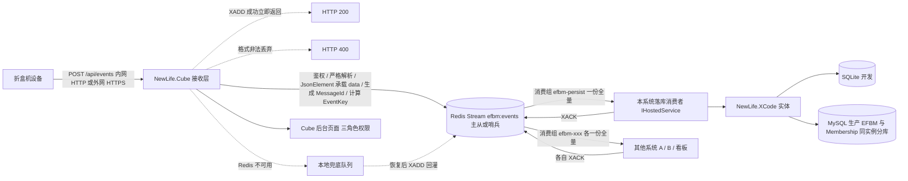

# 设备主动上报 API 后端 · 开发计划

按《需求说明.md》的编号推进。本文只讲「怎么做、分几步、怎么验收」，随讨论直接更新，不保留修订记录。

## 0. 开工前准备（对照 NewLife.Skills）

NewLife 官方维护 `NewLife.Skills`：全局指令 + 按关键词触发的专用指令 + 按需加载的 Skill + `@` 调用的 Agent。按 `development-process`（新建系统全流程）与 `project-architecture`（简单优先 + 扩展设计）的口径，P0 之前需完成下表准备；标 ✅ 的已就位，其余按阶段推进。

**已就位**：.NET SDK `10.0.303`；官方资产 22 项（10 skills / 8 agents / 3 专用指令 / 1 全局指令）已由官方脚本安装到 `%USERPROFILE%\.copilot\`，逐文件哈希校验与 `verify-assets.ps1` 均通过；上游仓库克隆在 `%USERPROFILE%\.workbuddy\vendor\NewLife.Skills`；WorkBuddy 项目级技能在 `.workbuddy/skills/newlife-efbm/SKILL.md`；`Doc/` 标准产出、根目录 `README.md` 与《上报字段字典》初版已完成。VS Code 1.133.0 已满足官方 Agent Plugin 的版本要求。

| 类别 | 准备项 | 状态 | 说明 |
| --- | --- | :--: | --- |
| AI 协作资产 | 安装 `NewLife.Skills` | ✅ | 官方脚本 `scripts/install-copilot-assets.ps1` 已安装 22 项到 `%USERPROFILE%\.copilot\{skills,instructions,agents}`（含 `newlife-global.instructions.md`）；更新 / 校验 / 卸载分别用同一脚本、`verify-assets.ps1`、`-Uninstall`。CLI 等价通道 `npx skills add https://github.com/NewLifeX/NewLife.Skills.git`（Node 22 已具备），**不要重复安装** |
| VS Code Agent Plugin | 官方推荐的 GUI 安装 | ⏳ 需手动 | 扩展视图 `Ctrl+Shift+X` 搜 `@agentPlugins` → 安装 **NewLife Skills**，或在 Copilot Chat 输入 `/plugin install`；要求 VS Code ≥1.96 + Copilot Chat，装完重启 VS Code。与脚本资产是同一批内容，不装也不影响全局资产生效 |
| WorkBuddy 项目级技能 | `.workbuddy/skills/newlife-efbm/SKILL.md` | ✅ | 加载标注、触发检查、官方硬约束摘要、项目当前共识与文档索引；完整规则指向官方原文，项目内不复制副本 |
| 需求文档 | 根目录《需求说明.md》 | ✅ | 用户指定名称，等同官方 `Doc/需求文档.md`，不搬迁；WHAT 与 FR-1~FR-28 齐备 |
| 官方流程文档 | `Doc/架构设计.md`、`Doc/功能清单.md` | ✅ | 架构设计含分层、组件所在工程、流程时序、11 条不变量、23 条设计决策（D-11 已决议为 4 工程，D-15~D-19 为 P2 接收链路决策、D-20~D-21 为 Beta 切片决策、D-22~D-23 为文本日志决策）、扩展点与收口记录；功能清单含拆分决策表、130 个功能点的实现 / 测试 / 注释三维状态、统计与待修复项 |
| 上报字段字典 | `Doc/上报字段字典.md` | ✅ | 按示例文件当前版本冻结（`ParseVersion=1.0`）：信封 / 6 类事件 `data` 字段、接收端生成字段、状态字典初版、`ParseWarning` 编码、字段演进流程与样例瑕疵；不等对方后续清单即可开工 |
| 文档降级说明 | `Doc/竞品分析.md` | ✅ | 内部接收端无外部竞品，改为技术路径对比 + WHY NOT；未经核实的产品数据不写入，含功能遴选结果 |
| AI 协作声明 | `README.md` | ✅ | 项目类型 `net10.0`、构建 `dotnet build`、测试 `dotnet test`、核心工程列表、文档索引与官方 Skills 状态；`dev-loop` Agent 优先读取 |
| 工程骨架 | `EFBM.sln` + 4 工程 + `src/EFBM.Data/Model.xml` | ✅ | P1 已建立、P2 已接入接收链路：`Directory.Build.props` 统一 `net10.0`、10 张实体由 `xcode Model.xml` 生成、契约层 / 配置 / 启动自检 / `RedisEventQueue` / 单端点 / 三模式鉴权 / 宽容解析 / 降级回灌；`dotnet build` 0 警告 0 错误、`dotnet test` 165 项通过；P1/P2 运行时验收项因本机无 Redis ≥ 6.2 / MySQL 未执行，见 §3 表下说明；详细状态见功能清单 |
| 代码规范 | 全局指令硬约束 | 🔧 全程（P1 起） | 加载标注、兼容性、命名 / 类型 / 风格、防御性注释、内置工具优先、工作流；`xcode.instructions.md` / `cube.instructions.md` 按关键词触发；P1 起交付的代码按此约束执行 |
| 测试策略 | `testing-strategy` / `e2e-testing` | 🔧 全程（P1 起） | xUnit 单测 165 项通过（全部带中文 `DisplayName`），覆盖契约 / 骨架 / 配置 / 解析 / 鉴权 / 编排 / 端点 / 回灌 / 文本日志；SQLite 集成测试（双数据库矩阵、队列故障注入）与 Cube 后台 E2E（Playwright，二期）按阶段补 |
| 环境与工具 | `NewLife.Templates`、`xcodetool`、Redis、MySQL | ✅ / 🔧 | ✅ 已核实并安装：`NewLife.Templates 1.1.2026.207`（含 `cube` / `cubeapi` / `xcode`）、`xcodetool 11.25.2026.1109-beta1547`（命令为 `xcode`）、.NET SDK `10.0.303`。官方 `xcode` 模板产出 **`Model.xml`** 且默认 `netstandard2.0`，`cube` 模板默认 `net10.0`；P1 用 `Directory.Build.props` 统一 TFM。Redis ≥ 6.2 与 MySQL 由部署环境提供 |
| 演进流程 | 变更路由 → 文档回流 → 架构图 → 收敛评审 | 🔧 全程 | 字段字典已按示例当前版本冻结于 `Doc/上报字段字典.md`（`ParseVersion=1.0`）；对方字段清单变更 → 回流字典与需求说明 §3.7 → 更新架构图 → 评审后再固化；里程碑用 `doc-sync` / `implementation-audit` 收敛体检 |

常用资产对照：`project-init`（脚手架）、`xcode-data-modeling`（模型设计）、`cube-mvc-backend`（后台页面）、`dev-loop`（逐项迭代开发）、`code-review`（规范审查与待修清单）、`doc-sync` / `implementation-audit`（文档与实现一致性）、`xml-comment-enrichment` / `doc-writer`（注释与文档）。

## 1. 落地顺序

三段依次推进：**同步接收链路**（无 DB IO）→ **异步消费链路**（全量落库）→ **Cube 宿主与后台页面**（管理与运维）。



## 2. 工程结构与脚手架

按《架构设计.md》D-11 决议收敛为 **4 个工程**：队列 / 服务 / 消费者保留逻辑分层，但作为 `EFBM.Web` 内的目录，不单独建 csproj；只有一个入口应用，不预建空 Service 工程。

```
EFBM.sln
Directory.Build.props        # 统一 net10.0、LangVersion、Nullable、公共程序集属性
src/
  EFBM.Core/                 # 契约：EventNames、EventEnvelope、StreamMessage、EventFieldRegistry、
                             #       EventKeyBuilder、错误码、IEventQueue / IEventHandler（不依赖 Web / DB）
  EFBM.Data/                 # XCode 数据层：Model.xml + xcode 生成的实体 .cs / .Biz.cs
  EFBM.Web/                  # 唯一宿主：NewLife.Cube（ASP.NET Core）
    Controllers/             # 上报端点 + 自定义后台页面控制器
    Queue/                   # Stream 封装、消费组、XACK / AutoClaim、安全裁剪、本地兜底、死信
    Services/                # 三模式鉴权、宽容解析、MessageId / EventKey、聚合统计
    Consumers/               # efbm-persist 落库组 + Handlers/ 事件处理器注册表
    Views/ Areas/            # 后台页面（需求说明 §6）
    appsettings*.json        # 内网 / 外网、SQLite / MySQL 配置
  EFBM.Tests/                # xUnit：单测 + 双数据库 / 多消费组 / 字段扩展 / 故障注入
Doc/                         # 架构设计 / 功能清单 / 竞品分析 / 上报字段字典 / 上报流接入说明
```

```bash
dotnet new install NewLife.Templates           # 本机已装 1.1.2026.207，含 cube / cubeapi / xcode
dotnet tool install xcodetool -g --prerelease # 本机已装，调用命令是 xcode
dotnet new cube  -n EFBM.Web  -o src/EFBM.Web
dotnet new xcode -n EFBM.Data -o src/EFBM.Data
xcode src/EFBM.Data/Model.xml                 # 生成 .cs（可覆盖）与 .Biz.cs（不覆盖）
```

> 已核实的模板事实：`cube` 模板默认 `net10.0`，`xcode` 模板默认 **`netstandard2.0`**，必须用 `Directory.Build.props` 统一；模型文件名是 **`Model.xml`**（`Nodes/Model.xml`、`Projects/Model.xml` 这类按模块分目录），`xcode` 工具用 `xcode <模型文件>`；模板自带的演示 Areas / 服务 / 星尘注册代码在 P1 精简。工具名是 `xcodetool`，**命令是 `xcode`**。

Cube 启动骨架（按官方模板实际写法精简，P1 落地；P2 已接入端点与兜底回灌，P3 在此扩展消费者）：

```csharp
using NewLife.Cube;
using NewLife.Log;

XTrace.UseConsole();                        // 控制台日志 + 全局异常拦截

var builder = WebApplication.CreateBuilder(args);
var services = builder.Services;

services.AddControllersWithViews();
services.AddCube();                          // 权限、菜单、实体控制器扫描
services.AddEFBMQueue();                     // 共享上报流（惰性构造，首次写入才连 Redis 建组）
services.AddEFBMReceive();                   // P2：解析 / 鉴权 / 入流编排 / 本地兜底回灌

var app = builder.Build();
StartupDiagnostics.Log(app.Configuration, app.Environment, efbm);
app.UseCube(app.Environment);
app.UseAuthorization();
app.MapControllerRoute("default", "{controller=CubeHome}/{action=Index}/{id?}");
app.Run();
```

上报控制器 `[AllowAnonymous]` + 自定义密钥校验，路由固定 `api/events`，不带版本号。P2 已注册 `EventIngestService` 与 `FallbackRequeueService`（`IHostedService`）；落库消费者（P3）与安全裁剪任务（P4）按阶段注册，不预注册空壳代码。队列构造期不连 Redis，`SetGroup` 延迟到首次写入 / 读取，这样 Redis 故障时异常落在写入调用上、能被接收层捕获并降级，而不是在 DI 解析阶段变成 500。

## 3. 阶段计划

| 阶段 | 目标 | 主要任务 | 验收标准 |
| --- | --- | --- | --- |
| **P0 基线** | 冻结契约 | 完成 §0 全部准备；评审需求说明；确定部署与安全基线（内外网 / HTTPS / 三角色）；确定 Cube 主题与菜单结构；确认共享上报流的消费组命名与外部系统接入方式；**§3.7 字段扩展策略与《上报字段字典》初版已按示例当前版本冻结（`ParseVersion=1.0`），不等对方后续清单**；**工程划分按《架构设计.md》D-11 决议收敛为 4 个工程** | 接口契约、Stream 消息体、消费组命名、字段字典初版、页面清单、测试用例签名冻结；`Doc/` 标准产出与 README 声明就位、§0 标 ✅ 的准备项验收通过 |
| **P1 骨架 + 数据层 + 队列** | 能连库、能入流 | 按 D-11 建立 4 个工程结构（Queue / Services / Consumers 为 `EFBM.Web` 内目录）；**统一目标框架 `net10.0`**（`Directory.Build.props` 统一 TFM，`dotnet new cube` / `xcode` 模板生成的 csproj 一并调整）；编写 `Model.xml`（需求说明 §5.1 全部实体，含 `AppCredential`、逐件明细、`StreamId`、`DataJson/ExtJson/UnknownFields/ParseVersion` 与人工处理字段）；`xcode Model.xml` 生成实体（`.cs` 覆盖、`.Biz.cs` 不覆盖）；`EFBM` / `Membership` 同实例分库连接串（SQLite / MySQL 两套）；Redis 主从 / 哨兵连接与本地兜底开关；`FullRedis.GetStream` + `SetGroup` 建 `efbm-persist`；**核实并固定 `MaxLength` / `Expire` / `MaxRetry` / `FromLastOffset` / `BlockTime` 配置，Redis 版本 ≥ 6.2 自检**；`Migration=On`；两张全量表按月分表；**字段固化演练**（模型加一列 → 自动加列 → 从 `RawJson` 回溯回填） | 全部工程 TFM 为 `net10.0`、`dotnet --list-runtimes` 含对应 ASP.NET Core Runtime；SQLite / MySQL 下自动建表成功；`XADD` / `XREADGROUP` / `XACK` / PEL 未确认重投四项行为验证通过；**建两个消费组各拿到全量消息、组内两消费者分摊不重复**；**新增一列在两种数据库自动加列成功、历史回填条数一致且 `.Biz.cs` 未被覆盖**；启动日志打印 provider、Redis 版本与地址、Stream key、消费组名、部署环境 |
| **P2 接收链路**（关键路径） | 快进快出、非法即弃 | 单端点 `POST /api/events`；`AppCredential` 按设备发放与三模式鉴权（接收层校验 `X-App-Key` / `X-App-Secret` / `deviceId` 一致，Header 名可配）；严格解析信封 + **`data` 用 `JsonElement` 承载、禁止强类型 DTO**；字段缺失 / 类型不符 / 未知字段只打 `ParseWarning`；生成 `MessageId` 与 `EventKey`；按 §3.6 组装消息体（含 `rawJson`、`replayOf`）；一次 `XADD` 即 200；错误码；降级写 `LocalQueueFallback` | 合法报文同步链路**无任何 DB 写**、P99 < 50ms；非法 JSON / 缺字段返回 400 且不留 Stream 或库记录；三种鉴权与按设备凭据校验各自通过；未知 `status` / 未知 `event` / 时间偏差均正常入流；**`data` 里新增字段、嵌套对象、数组均不拒绝且原文完整入流**；外网配置下匿名上报被拒 |
| **P3 异步消费与全量落库**（✅ 2026-11-12 已完成） | 不丢、不重、全量、可共享 | `IHostedService` 落库组消费者：`TakeAsync` 批量取 + PEL 优先重投 + **显式 `XACK`**；不使用框架自动 Ack 的消费循环（`MaxRetry` 超限会静默丢弃），改由进程内重试计数 → 写 `DeadLetter` + 告警后才确认；PEL 消息下一轮先读重投；**`IEventHandler` 注册表 + 未知事件兜底 handler（7 个）**；三元组幂等（`EventKey` 全链路去重、`RepeatCount` 观测重复投递）；逐件明细全量保存；`ExtJson` / `UnknownFields` / `ParseVersion` 落库；累计值取大收敛；`status` 原值 + 展示字典；**按各组最小已确认 ID 的安全裁剪任务顺延至 P4**（D-3 已决议） | 消费失败不 Ack → PEL 重投 → 最终落库；同一报文重复投递只产生 1 条原始报文 + 1 条明细；**逐件 1000 条明细 1000 条全量保存且工单累计值正确**（已测）；乱序不回退；**超限消息进死信且未自动丢弃**；**未 Ack 的消息不会被长度/过期裁剪删除**；**未知事件原样落库且未知字段汇总可见** |
| **P4 Cube 宿主 + 后台页面** | 主服务可上线、可管理 | `AddCube/UseCube`；上报控制器 + 三模式鉴权；Swagger；`Membership` 分库；`IHostedService` 托管消费者；实现需求说明 §6 全部页面，尤其**原始报文管理**（检索 / 查看 / 标记 / 重放 / 导出 / 手动清理，清理前强制先导出归档，无自动任务）、**字段字典 / 新增字段监测**与**队列与消费组监控**（各组 lag / PEL / 消费者 / 最慢组 / 僵尸组 / 裁剪水位）；重放重新 `XADD` 并带 `replayOf`；消费组登记清单；三角色菜单权限；凭据脱敏、二次确认与操作审计 | 上报立即返回 200；Swagger 可见全部接口；后台可查设备 / 工单 / 逐件明细 / 故障 / 原始报文 / 死信 / 字典 / 字段字典 / 消费组监控；原始报文手动标记与重放可用，重放后外部组能收到带 `replayOf` 的消息；**未知字段在监测页可见并可登记中文名 / 类型 / 所属事件**；未导出归档时清理被拒绝；运维不可见凭据管理与报文清理，只读账号写操作被拒；关掉消费者后上报仍 200 且数据留在 Stream |
| **P5 查询统计与运维部署** | 可用、可运维 | 查询 API 与产量统计；`StatusDict` 展示映射；`/health` 含 Redis 主从 / DB / 消费者 / **各消费组 lag 与 PEL**；Stream 长度、Redis 内存、写入 / 消费速率、Ack 失败、死信告警；`NewLife.Agent` 注册服务；**内网 HTTP / 外网 HTTPS 两套部署配置与手册**（外网禁匿名、只暴露上报端点与后台入口、Redis 不对公网）；**《上报流接入说明》含字段演进条款**（按名取值、忽略未知字段）；《上报字段字典》按对方清单更新（初版已冻结）；数据库切换手册 | 查询 / 统计符合验收用例；状态原值正确映射、未知值原样显示；内网与外网部署各跑通核心用例；前台与守护进程两种部署验证；SQLite ↔ MySQL 切换演练通过（不改代码）；外网配置缺 HTTPS 或启用匿名时启动自检失败；系统无自动清理任务；外部消费组可独立接入并拿到全量 |
| **P6 联调、压测与交付** | 达到上线条件 | 与设备 / 模拟器联调（**含新增字段与新增事件报文**）；多台机器逐件并发；**多消费组并存、最慢组堆积**下的积压与追赶压测；Redis 宕机降级恢复；消费进程崩溃 PEL 重投；消费组误删重建重放；裁剪安全性验证；死信与原始报文手动重放；**字段固化闭环与历史回溯回填验证**；明细条数与上报数逐条核对；补齐文档 | 峰值并发下接收端 0 个 5xx、P99 达标；返回 200 的数据最终全部落库、逐件明细条数与上报数一致、无重复计数；故障演练后数据可恢复；字段固化后历史数据完整补齐；交付物齐全 |

依赖关系：`P0 → P1 → P2 → P3 → P4 → P5 → P6`（线性推进；P4 依赖 P3 的落库，P5 依赖 P4 的宿主与菜单）。

> **Beta 最小版本（P2 与 P3 之间的可交付切片）**：目标是「设备能上报、每条原文都落盘」，Redis 与消费入库都后补，**不因为赶 Beta 而降低 P3 的质量要求**。
> 交付内容：① **文本请求日志**——每条 `POST /api/events` 一行 JSON 追加到 `logs/api/api-yyyyMMdd.log`，含报文原文、`deviceId` / `event` / `eventKey` / 判定结果，按天滚动、超限切分、保留期与 `fsync` 可配，400/401/403 同样留痕且绝不落密钥；② `EFBM:RedisEnabled=false` 纯日志模式，不连 Redis、不写兜底表，`message=accepted-by-log`；③ 引入 `XCode.SQLite`，`EFBM.db` / `Membership.db` 首次启动自动建表，Beta 不再依赖数据库服务器；④ `EFBM:Beta:*` 配置驱动凭据引导，幂等补齐设备与凭据（P4 后台发放页面未上线时的唯一可用通道，仅内网允许）；⑤ `/health` 增加请求日志状态（`written` / `failed` / `currentFile`）并纳入 `degraded` 判定；⑥ `tools/beta-smoke.ps1` 一键冒烟；⑦ 《Doc/Beta运行手册.md》。
> 验收判据：`POST /api/events` 返回 200 且 `redis.streamLength` 随之增长；Redis 停机时仍返回 200 且 `fallback.pending` 增长，Redis 恢复后由回灌服务补入 Stream。
> 明确不做：消费者落库、后台页面、安全裁剪、压测；这些仍按 P3~P6 验收标准执行。

> **P1 验收实际结果**：`net10.0` 四工程、`Model.xml` 十张实体与生成链、契约层 / 字段字典 / 幂等键 / `StreamMessage`、`RedisEventQueue` 接入与三项默认行为接管、内外网配置与启动自检均已交付；当时 `dotnet build` 0 警告 0 错误、`dotnet test` 42 项通过，加列→还原演练验证 `.Biz.cs` 不覆盖（当前测试总数见 §0 与功能清单）。
>
> **P2 验收实际结果**：单端点 `POST /api/events`、三模式鉴权（`Anonymous` / `Basic` / `AppKeyAppSecret`，凭据绑定 `deviceId`、401 / 403 分级、Header 名可配）、`JsonDocument` 严格解析 + W100~W108 宽容字段、UUID `MessageId` 与三元组 `EventKey`、§3.6 冻结的 9 字段 Stream 消息体、一次 `XADD` 即 200、Redis 故障写 `LocalQueueFallback` 仍 200 且恢复后回灌、双失败 503 均已交付。**真实端到端已在本机跑通**（便携版 Redis 5.0.14.1 + SQLite）：`POST` 返回 `queued=true` 后 `XLEN` 0→1，`XINFO GROUPS` 自动出现 `efbm-persist`（`last-delivered-id=0-0`），`XREVRANGE` 中 9 个字段与 `rawJson` 原文完整；停掉 Redis 后同一请求返回 200 + `queued=false`、`/health` 的 `fallback.pending` 变为 1；Redis 恢复后 30 秒内日志出现「本地兜底开始回灌 1 条」，`XLEN` 增长且 `pending` 归零，回灌消息保留原 `messageId` / `eventKey`。`dotnet build` 0 警告 0 错误、`dotnet test` 165 项通过。**文本日志已在本机实测**（Windows + SQLite，`RedisEnabled=false`）：正常报文返回 `200 / accepted-by-log / logged=true`，日志新增一行且 `raw` 与原文逐字一致；非法 JSON 与缺凭据分别留下 `status=400 / 401` 的行，`/health` 的 `requestLog.written` 递增、`failed=0`、`currentFile` 指向当天文件；切到 `RedisEnabled=true` 后同一报文返回 `accepted / queued=true`，`XLEN` 增长。未做的部分：`P99 < 50ms` 未压测，MySQL 与 Redis ≥ 6.2 专属命令（`XTRIM MINID` / `XAUTOCLAIM`）未验证。
>
> **验收范围说明（按实际执行）**：本机已完成 **SQLite 自动建表与凭据 / 兜底表读写**（`SqliteSmokeTests`）、**接收链路的真实 HTTP 调用**（200 / 400 / 401 / 403 / 降级 200 / `/health` 判读）、**真实 Redis 的 `XADD` / 建组 / `XLEN` / 降级回灌闭环**（便携版 5.0.14.1，非 6.2）、**文本请求日志的真实文件落盘 / 滚动 / 保留 / 脱敏**（`FileRequestLogTests` + 本机手工验证）。**MySQL 方言与双库切换**、**Redis ≥ 6.2 的 `XTRIM MINID` / `XAUTOCLAIM`**、多组广播 / 组内分摊 / PEL 重投 / 裁剪安全性、P99 压测**未执行**，需在目标环境补跑（§7 用例 1~4、8~15）。`ProbeRedisOnStartup` 的版本探测留待 P5。
>
> **开发环境约束**：Windows 开启 Smart App Control 时，新编译的未签名 `EFBM.*.dll` 会被应用程序控制策略拦截（`0x800711C7`），表现为 `dotnet build` 正常而 `dotnet test` 失败。本机已在 Windows 安全中心关闭 SAC（该版本开关可逆），测试工程保持标准 `ProjectReference`；换机器需同样处理，Defender 排除项 / `Unblock-File` 对 SAC 无效。

> **P4 进度（安全裁剪 + 后台接口，2026-11-12 已完成）**：
> ① **安全裁剪**（P3 顺延）：`StreamTrimHostedService`（`IHostedService`）周期驱动，`RedisEventQueue` 实现 `IStreamTrimmer`，纯算法 `StreamTrimCalculator`（取各组边界最小值、与「最近 N 天」保留下限取小，任一組边界不可解析则整体保守跳过）单测覆盖；底层 `XTRIM MINID` 需 Redis ≥ 6.2，低于该版本首次执行报错即自动停跑并记日志。`EFBM:SafeTrimEnabled` / `SafeTrimIntervalSeconds` / `SafeTrimMinRetentionDays` 可配，任一项关闭则后台任务不自启。
> ② **后台接口**（页面依赖它，先落后端）：`GET api/admin/events` 组合过滤 + 分页、`GET api/admin/events/{id}` 原文详情、`POST api/admin/events/{id}/mark` 手动标记、`POST api/admin/events/{id}/replay` 单条重放（新 `MessageId` + `replayOf`，`EventKey` 与原文不变，一次 `XADD` 广播所有组）、`GET api/admin/deadletters` + `GET .../{id}` + `POST .../{id}/replay`（成功才回写 `ReplayStatus` / `ReplayAt` / `ReplayBy`）。统一 `{code,message,data}` 响应体；鉴权走 Cube 登录态，未认证实测返回 401 并跳 `/Admin/User/Login`。
> ③ **宿主中间件顺序修正**：`UseCube()` 内部一次性完成 `UseRouting` + `UseEndpoints`，原「`UseCube` 后接 `UseAuthorization`」导致端点带授权元数据却没有授权中间件而 500；改为显式 `UseRouting → UseAuthentication → UseAuthorization` 早于 `UseCube`（决策 D-30），并回归验证 `POST /api/events` 仍 200。
> ④ **导出 / 清理 / 批量重放**：`EventExportService` 按接收时间导出 CSV（UTF-8 BOM，原文列完整，单次上限 20 万条），返回导出凭证（范围 + 最大主键 + 条数 + 文件 SHA-256，默认 30 分钟有效）；`POST api/admin/events/cleanup` 必须凭凭证执行，无凭证 / 已过期 / 文件被改动一律拒绝，且只删 `Id ≤ 导出时最大主键` 的部分——导出后新到的数据不会被顺手删掉。`ReplayRangeAsync` 按范围批量重放，默认 500 / 硬上限 2000，`truncated` 标明是否被截断。**没有自动清理任务**（FR-15）。
> ⑤ **三角色权限矩阵**（AUTH-3a）：`AdminPermissionMatrix` 在 `EFBM.Core/Security` 定义三角色 × 10 个动作（查询 / 原文 / 标记 / 重放 / 导出 / 下载 / 清理 / 死信查询 / 死信详情 / 死信重放），纯函数判定、无框架依赖；`[RequireAdminOperation]` 作为授权过滤器挂在每个动作上，权限不够返回 403 统一信封（未登录仍是 401）；`GET api/admin/permissions` 返回当前角色、允许动作与全量矩阵，供页面收敛菜单与按钮。角色解析三层：`EFBM:Admin:Users` 用户名映射（Cube 初始超管 `RoleIDs` 为空，票据无角色声明，默认配 `admin`）→ 票据角色声明（多值取最高）→ `EFBM:Admin:RoleAliases` 现场组名映射；三层都落空即 403，不猜角色。删除类动作（清理）只给管理员，运维最多导出与重放。
> ⑥ **登录态修正（实测发现）**：用 Cube 默认账号登录后 `/Admin` 返回 200，但 `/api/admin/*` 仍 401 —— `[Authorize]` 走 ASP.NET 授权中间件，而 Cube 的登录用户要到 `UseCube` 内部才被还原，授权中间件必须早于 `UseCube`（D-30），中间件层永远看到未认证请求。改为：后台基类撤掉 `[Authorize]`，由 `[RequireAdminOperation]` 动作过滤器统一判「未登录 401 / 无角色 403 / 角色不够 403」，身份经 `IAdminIdentityAccessor` 从 Cube 当前用户取（退回 `HttpContext.User` 兜底）。实测：未登录 401 信封、`admin` 登录后 `permissions` 200（`role=admin`）与 `events` 200、把 `admin` 临时配成 `viewer` 后 `cleanup` 403「角色「只读」无权清理原始报文」而 `events` 仍 200。
> ⑦ **二次确认与审计**（AUTH-3b）：`[RequireConfirm]` 在服务端强制二次确认——重放（单条 / 按范围 / 死信）与清理必须带 `X-Confirm: <动作枚举名>`，缺头或值不对返回 400（页面弹窗只是配合，不替代）；`[Audit]` 动作过滤器把每次写操作（标记 / 重放 / 批量重放 / 导出 / 清理，成功失败都记）写进 Cube `Log` 表（`Category=EFBM后台`，含操作人、IP、追踪 ID、目标主键、结果与参数摘要，长度按实体元数据截断），`GET api/admin/audits` 按动作 / 操作人 / 时间 / 成败分页查询，最低运维。审计写失败只打应用日志，不影响业务（决策 D-34）。
> 当前 `dotnet build` 0 警告 0 错误、`dotnet test` 311 项通过（原 241 + 权限矩阵 53 项 + 二次确认与审计 17 项）。P4 剩余：Cube 页面（报文列表 / 原文查看 / 死信页 / 字典维护 / 审计页）。

## 4. 关键实现要点

- **鉴权在接收层**：Cube 权限体系面向后台登录用户，上报端点标记 `[AllowAnonymous]` 后由 `RequestAuthenticator` 独立校验设备凭据；校验通过后才解析入流（FR-2）。`X-App-Key` / `X-App-Secret` 为默认 Header 名，走配置项读取；`Basic` 模式复用同一张 `AppCredential`（用户名 = AppKey、密码 = AppSecret），三种模式语义一致。401 统一文案防止枚举有效 AppKey，403 用于停用凭据与 `deviceId` 串用；密钥比较用定长时间比较，响应与日志均不含 Secret。
- **三元组幂等全链路统一**：`EventKey = SHA1(event|deviceId|timestamp)` 是原始报文、逐件明细与聚合表共同的唯一键；`MessageId` 只做消息追踪。重复投递、PEL 重投、消费组重建重放命中唯一约束后直接 Ack 并累加 `RepeatCount`（需求说明 §5.2）。**`EventKey` 不含 `data`**，字段增减不影响去重。
- **同步链路零 DB 写**：接收层只做鉴权、解析、生成两个键、一次 `XADD`、返回 200；任何下游故障都不得改变响应码。凭据在 `DeviceCredentialStore` 做进程内短 TTL 缓存（默认 60s），稳态连数据库读都不产生；匿名模式完全不查库；`LastUsedAt` 不在接收层更新（否则每条上报都会写库）。**唯一例外**是 Redis 故障降级路径写一次 `LocalQueueFallback`，这是保住「返回 200 的数据最终落库」的必要代价。首次连接触发 `Migration=On` 自动建表属一次性初始化，不计入逐条上报路径。
- **字段扩展（需求说明 §3.7）**：遵循官方 `project-architecture` 的「简单优先（约 90% 覆盖）+ 扩展设计」——**不做**运行时动态建列 / EAV / 字段级 API 版本化 / 每种事件封闭 DTO。固定列 + `RawJson` 全量 + `DataJson` + `ExtJson` + `UnknownFields` + `ParseVersion` 构成兜底；`IEventHandler` 注册表让新增事件只加一个 handler；`EventFieldRegistry` 保存字段字典。XCode 的 `Migration=On` 支持「模型加列、上线自动同步」，因此固化路径是改模型 → 重新生成 → 自动加列 → **从 `RawJson` 回溯回填历史**（设备不重发，这是唯一补历史的途径，每次固化必须执行并留记录）。
- **Stream 共享流配置**（需求说明 §3.6）：Stream key `efbm:events`；`Group=efbm-persist` 由 `SetGroup` 自动创建且启动时确保存在；`Consumer` 用「主机名 + 进程 ID」保证唯一；`FromLastOffset=false`（新组从头部开始，组重建重放由幂等兜住，优先不漏）；`BlockTime` / 批量按机器台数调；外部组用 `efbm-<系统名>` 并登记。所有配置项集中在一处，禁止散落在业务代码。
- **禁止静默丢弃**（已核实 `NewLife.Redis 6.4.2026.201` 源码）：`MaxLength=100万` 会触发 `XADD MAXLEN ~` 与定时 `XTRIM MAXLEN`，`Expire=7天` 会触发定时 `XTRIM MINID`，二者均**不判断消费组是否已消费**；`MaxRetry=10` 由 `TakeMessagesAsync` 内部的 `RetryAck()` 把超限消息自动 Ack 丢弃。P1 的 `EFBM.Web/Queue/RedisEventQueue.cs` 已按下列方式接管：① `MaxLength=0`、`Expire=TimeSpan.Zero` 关闭全部自动裁剪；② `MaxRetry=Int32.MaxValue`，并改用 `ReadGroupAsync(group, consumer, count, block, ">", ct)` 直接读取 + `Ack(group, id)` 显式确认，绕开 `RetryAck()`；③ 先以 `id="0"` 读当前消费者 PEL 让未确认消息优先重投，跨消费者 `Claim` / AutoClaim 在 P3 补；④ 消息体以 JSON 写入 `__data` 字段（`PrimitiveKey`），消费时从 `Message.Body` 的名值交替数组取值；⑤ 安全裁剪按所有组最小已确认 ID 用 `XTRIM MINID`（Redis ≥ 6.2），P4 落地。超限消息先写 `DeadLetter` + 高优告警再确认，交后台人工重放。
- **队列高可用**：Redis 生产按主从 / 哨兵连接，版本 ≥ 6.2（建议 7.x），本地兜底默认开启；`/health` 同时探测主从状态、Stream 长度与各消费组 lag（需求说明 §2、§7）。
- **分库连接**：`EFBM` 业务库与 `Membership` 权限库同实例分库，两套连接串各自配置；SQLite 开发环境保持同名配置便于切换。
- **内外网双部署**：一套代码两套配置。外网强制 HTTPS、禁用匿名认证、仅暴露 `POST /api/events` 与后台入口，**Redis 不对公网**，外部系统走查询统计 API；内网可走 HTTP 且允许外部系统在内网 / VPC 订阅。启动时自检外网配置的协议、认证模式与 Redis 暴露面，配置不符直接失败并打印实际协议、认证模式与 Redis 地址。
- **批量与顺序**：默认 200 条 / 200ms 攒批事务写；同 `orderId` 分区串行，`CompletedQty` 按累计值取大收敛。同组多实例由 Stream 自动分摊，不需要分布式锁。
- **两张全量表**：按月分表 + 组合索引 + `BatchInsert`；`StreamId` 建索引便于定位与重放；`ExtJson` 不建常规索引，需要高频查询时按 §3.7 固化；不做定时清理，人工在后台按时间范围导出后清理。
- **后台页面**：自定义 Controller + View，纳入 Cube 菜单与三角色权限；清理前校验同时间范围导出归档记录，否则拒绝；重放生成新 `MessageId`、带 `replayOf` 并广播给所有消费组，命中已落库 `EventKey` 时跳过，不覆盖原记录；敏感操作二次确认 + 审计日志。
- **数据库切换**：连接串或环境变量 `XCode_EFBM` 决定 provider，启动时 `DAL.Create("EFBM")` 打印实际 provider。
- **响应体冻结与降级语义**：统一 `{code,message,data}`；成功 `code=0`，失败 `code` 等于 HTTP 状态码且 `data=null`。降级时结构不变，仅 `queued=false`、`message=accepted-by-fallback`，设备只按 HTTP code 判定成功。字段名用 `JsonPropertyName` 显式固定，不依赖宿主的 camelCase 策略，二期换轻量宿主也不会变形。400 丢弃与 401/403/503 一律把**报文原文**写进日志：设备不重发，日志是人工补录的唯一线索。
- **降级与回灌**：`XADD` 抛异常时写 `LocalQueueFallback`（存完整 Stream 消息体 JSON，设备原文在其 `rawJson` 内），仍返回 200；`FallbackRequeueService` 按配置的间隔 / 批量重新 `XADD`，保留原 `messageId` / `eventKey` / `replayOf` 供所有消费组按幂等键收敛。回灌失败只累加 `RetryCount` 并告警，**绝不删除兜底记录**；无待回灌记录时连队列对象都不解析，未装 Redis 的开发机也能启动。降级写入传 `CancellationToken.None`，即使请求中途断开也把数据保住。哨兵值 `1970-01-01` 表示「未回灌」——`DateTime.MinValue` 在 MySQL `DATETIME` 下写不进去，`NULL` 又无法用普通条件查询。
- **队列构造期不连网**：`RedisEventQueue` 只设置参数，`SetGroup` 延迟到首次 `AddAsync` / `TakeAsync` 并用双检锁保证只建一次。若建组放在构造函数里，Redis 故障会让 DI 解析直接抛异常、请求变 500，接收层根本走不到降级分支；放在写入路径上才能被 `EventIngestService` 捕获。
- **外网 HTTPS 不做 3xx 重定向**：设备通常不跟随重定向，一次跳转就是永久数据缺口。外网强制 HTTPS 由启动自检 + Nginx / IIS 反代层保证，端点收到明文请求只记警告、照常接收；反代需透传 `X-Forwarded-Proto` / `X-Forwarded-For`。
- **Stream 消息体仍是 §3.6 的 9 个字段**：解析层产出的 `ParseWarning` / `ExtJson` / `UnknownFields` 不塞进消息体，P3 消费者用同一个 `EventEnvelopeParser` 从 `rawJson` 重解析得到，外部消费组的按名取值契约不变。

## 5. 风险与应对

| 风险 | 应对 |
| --- | --- |
| 全量原始报文 + 全量逐件明细膨胀 | 按月分表、批量写、组合索引、后台人工归档；容量监控告警 |
| 设备不重发，拒绝即永久缺口 | 只拦 JSON 格式错误；401/403/503 高优告警；上线前按设备灰度联调 |
| **强类型 DTO 静默丢弃新增字段** | `data` 用 `JsonElement` 承载、按名取值 + 缺省；未知字段落 `ExtJson` / `UnknownFields`；原始报文全量留存（FR-25） |
| **新增字段只有「从今天起」有数据** | 固化时从 `RawJson` / `DataJson` 回溯回填并留记录；字段字典登记首次出现时间（FR-28） |
| **新增事件要改接入层** | `IEventHandler` 注册表 + 未知事件兜底 handler；补 handler 后可从历史原文重放解析（FR-26） |
| **外部系统因未知字段解析报错** | 接入说明要求按名取值、忽略未知字段；Stream 消息体带 `rawJson` 原文，新字段自动透传 |
| **Stream 自动裁剪 / 过期静默删除未消费消息** | 关闭 `MaxLength` / `Expire` 自动裁剪，改按各组最小已确认 ID 安全裁剪 + lag 告警；数据库为长期真相源，窗口外从库重放（FR-22、FR-23） |
| **`MaxRetry=10` 超限自动丢弃坏消息** | 不用自动 Ack 消费循环，显式 `XACK`；超限先写死信表 + 告警再确认，后台人工重放 |
| **外部消费组长期停机导致 Redis 内存膨胀** | 各组 lag / PEL / Stream 长度与内存监控告警；超阈值通知对方消费或从库补数；僵尸组剔除需登记变更 + 审计 |
| **消费组误删 / 重建后从头重放历史全量** | `FromLastOffset=false` 优先不漏，`EventKey` 唯一约束兜住重复；组名登记与变更审计，禁止复用组名 |
| Redis 单点，且多系统共享放大影响面 | 主从 / 哨兵 + 本地兜底 + `XADD` 回灌；`/health` 监控；外部系统使用受限账号 |
| Stream 至少一次 / PEL 重投 / 组重建重放导致重复 | `EventKey` 唯一约束 + `RepeatCount` 观测 + 累计值收敛；外部系统各自幂等 |
| 并发消费乱序 | 按 `orderId` 分区；按 `timestamp` 与累计值收敛 |
| 凭据泄露、串用或公网暴露 | 校验凭据绑定 `deviceId` 一致；后台脱敏；外网强制 HTTPS + 禁用匿名 + 最小化暴露面；Redis 不对外网开放；可选 IP 白名单 / HMAC |
| 内外网配置混用 | 两套独立配置 + 启动自检（外网缺 HTTPS 或启用匿名即失败）+ 启动日志打印实际协议与认证模式 |
| 后台人工清理 / 重放误操作 | 清理前强制先导出归档并校验记录，二次确认 + 审计日志；重放广播给所有组并带 `replayOf`，命中已落库 `EventKey` 时跳过，不覆盖原记录 |

## 6. 交付物

- 可运行的 `EFBM.Web`（Cube 宿主，含后台页面与 Swagger）及其余工程源码。
- `Model.xml` 模型、生成的实体类与 `.Biz.cs` 扩展。
- 配置文件示例：SQLite / MySQL 连接串（含 `EFBM` / `Membership` 分库）、Redis 主从 / 哨兵与 **Stream / 消费组 / 裁剪 / 重试参数**、鉴权与默认 `X-App-Key` / `X-App-Secret` Header 名、状态字典、**内网 / 外网两套部署配置**。
- **《上报字段字典》**（`Doc/上报字段字典.md`，初版已交付，`ParseVersion=1.0`）：字段名、中文名、类型、所属事件、是否必填、是否已固化、首次出现时间与样例值，后续按需求说明 §3.7 随对方字段清单演进。
- **《上报流接入说明》**：Stream key、消息体字段、消费组命名规范、`XACK` 与幂等约定、重放语义、**按名取值与忽略未知字段的演进约定**、外部系统接入示例与监控指标。
- `Doc/` 标准产出：`架构设计.md`、`功能清单.md`（实现 / 测试 / 注释三维状态）、`竞品分析.md`（降级说明）；需求文档按用户指定命名保留在根目录 `需求说明.md`；`README.md` 含 AI 协作声明（§0）。
- 接口联调说明、《部署文档.md》（Linux 原生 systemd+Nginx / 宝塔面板、Windows IIS，含内外网 HTTPS、Redis 版本与容量规划、数据库切换）、运维手册。
- **《Beta 运行手册》**（`Doc/Beta运行手册.md`）与 `tools/beta-smoke.ps1` 冒烟脚本：最小版本的启动、凭据引导、文本日志格式与 `jq` 检索、`/health` 判读、Redis 侧核对命令与常见故障处理。
- 压测报告与验收记录。

## 7. 验收用例（最小集）

1. 6 类事件各上报一次 → 立即 200，同步链路无 DB 写；消费后数据符合事件落库规则。
2. 非法 JSON（含尾随逗号）/ 缺 `event`、`deviceId`、`timestamp` → 400 丢弃，不入流不落库。
3. 三种鉴权模式各自通过；凭据与报文 `deviceId` 不匹配 → 403；错误密钥 → 401 且告警；外网配置下匿名上报被拒；Header 改名后仍可正常鉴权。
4. 未知 `event` / 未知或空 `status` / 时间偏差 1 小时 / 负数数量 → 不拦截，原样入流落库。
5. 逐件完成连续上报 `completedQty=1..1000`（`timestamp` 逐件递增）→ 明细 1000 条全量保存、工单累计值收敛为 1000 且派生「已完成」；乱序不回退。
6. 同一报文（相同 `EventKey`）重复投递 3 次 → 原始报文 1 条、明细 1 条、`RepeatCount=2`，其余直接 Ack；相同三元组但 payload 不同仍按重复处理，保留首次报文。
7. 消费异常 → 不 `XACK` → 消息留在 PEL 由 AutoClaim 重投 → 最终落库；连续失败超过重试上限 → **进死信表 + 告警，不被自动丢弃**，后台手动重放后落库。
8. Redis 停机 → 写本地兜底且仍 200 → 恢复后 `XADD` 回灌落库；消费进程被杀 → PEL 未确认消息被其他消费者接管继续消费。
9. **多组广播**：`efbm-persist` + 两个外部组同时订阅 → 三个组各收到全量消息；任一外部组停机不影响落库组；同组两个消费者分摊且无重复处理。
10. **组重建重放**：删除并重建 `efbm-persist` → 从头重放历史全量 → 靠 `EventKey` 不产生第二条原始报文 / 明细，累计值不重复计数。
11. **裁剪安全性**：构造超过 `MaxLength` / `Expire` 的消息且仅部分组已 Ack → 未 Ack 消息不被删除；安全裁剪只删所有组最小已确认 ID 之前的消息。
12. **重放广播**：后台按时间范围重新写入 Stream → 所有消费组都收到带 `replayOf` 的新消息，外部系统按 `EventKey` 幂等，不覆盖已有记录。
13. 原始报文全量保存（含 `StreamId`），后台可检索、查看原文、标记、重放、导出、按时间范围手动清理；未先导出归档时清理被拒绝；系统无自动清理任务；管理员 / 运维 / 只读三角色权限边界符合需求说明 §6。
14. Cube 宿主 × SQLite / MySQL 两种组合全部用例通过；内网 HTTP 与外网 HTTPS 两套部署各跑通核心用例，外网缺 HTTPS 或启用匿名时启动自检失败；Redis < 6.2 时启动自检失败；外部系统可按接入说明独立订阅。
15. N 台设备逐件并发压测 + 多消费组并存（含一个刻意变慢的外部组）→ 0 个 5xx、P99 达标、积压可追赶、最慢组 lag 与 Redis 内存告警生效；返回 200 的数据最终全部落库且明细条数与上报数一致。
16. **新增未知字段**：`ORDER_COMPLETED` 的 `data` 里加 `boxType` / `operatorId` / 嵌套对象 → 仍 200，`RawJson` / `DataJson` 完整、`UnknownFields` 记录两个字段、`ExtJson` 可查、外部消费组收到原文；`EventKey` 与未加字段时完全一致。
17. **新增未知事件**：上报 `NEW_EVENT_X` → 不拒绝、原样入流、兜底 handler 只存原始报文并打标；补上对应 handler 后，历史报文可从 `RawJson` 重放解析出业务数据。
18. **字段固化闭环**：在 `Model.xml` 增加一个正式列 → `xcodetool` 重新生成（`.Biz.cs` 未被覆盖）→ 部署 `Migration=On` 自动加列 → 从历史 `RawJson` 回溯回填成功，回填前后条数一致且旧数据该列有值，留回填记录。
